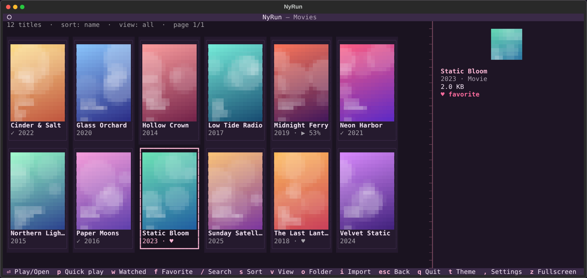

<h1 align="center">NyRun</h1>

<p align="center">
  <b>A cozy poster-based video &amp; music selector for your terminal.</b><br>
  Pick a film or an album, press <kbd>Enter</kbd>, VLC does the rest.
</p>

<p align="center">
  <a href="https://github.com/77nyan/nyrun/actions/workflows/ci.yml"></a>
  
  
  
  <a href="LICENSE"></a>
</p>

<p align="center">
  
</p>

NyRun turns a plain folder of movies, shows and music into a browsable library in your terminal: a poster grid, watched marks, search, resume, and one-key launch into **VLC**. It can also play links from the web. No database, no accounts, nothing scraped. Your files stay where they are.

## Contents

- [1.0 Install](#10-install)
- [2.0 Quick start](#20-quick-start)
- [3.0 Watch from a URL](#30-watch-from-a-url)
- [4.0 Keys](#40-keys)
- [5.0 Command line](#50-command-line)
- [6.0 Settings, themes and music](#60-settings-themes-and-music)
- [7.0 Troubleshooting](#70-troubleshooting)
- [8.0 License](#80-license)

## 1.0 Install

You need Linux, Python 3.12+ and [VLC](https://www.videolan.org/vlc/). The installer can fetch VLC and ffmpeg for you.

```bash
git clone https://github.com/77nyan/nyrun
cd nyrun
sudo ./install.sh
```

> [!IMPORTANT]
> `sudo ./install.sh` is the only way to install NyRun. Running it with `sh install.sh`, `bash install.sh` or without `sudo` is refused on purpose.

The installer opens a small full-screen menu:

| | Option | What it does |
|---|---|---|
| **1** | Install | Puts NyRun in `/opt/nyrun`, adds the `nyrun` command, offers to install VLC and ffmpeg |
| **2** | Update | Pulls the newest files and refreshes yt-dlp |
| **3** | Uninstall | Removes NyRun. Your library is never touched, and settings are kept unless you say otherwise |
| **4** | Quit | Leaves the installer |

Move with <kbd>↑</kbd> <kbd>↓</kbd>, choose with <kbd>Enter</kbd> or jump with <kbd>1</kbd>-<kbd>4</kbd>. For scripts: `sudo ./install.sh install|update|uninstall`.

## 2.0 Quick start

```bash
nyrun -createfolder      # makes ~/NyRun with Movies/ Series/ Shows/ Music/
nyrun                    # open the library
```

Put each title in its own folder, with a poster image next to the video:

```
NyRun/
├── Movies/Inception (2010)/   inception.mp4  poster.jpg
├── Series/Cowboy Bebop/       cover.png  Season 1/ep01.mkv  Season 2/...
├── Shows/Planet Earth/        ...
└── Music/Moon Songs (2020)/   01 - Intro.mp3  cover.jpg
```

<details>
<summary><b>Layout rules and bringing files in</b></summary>

- The folder name is the title. `(2010)` at the end becomes the year.
- A poster is any `.jpg`, `.jpeg` or `.png` in the folder (`poster`, `cover`, `folder` win). A loose video also works with an image of the same name next to it.
- Folders holding only a "sample" video and hidden files are ignored. A folder with several videos plays the biggest one.
- **Add a file:** press <kbd>a</kbd> or run `nyrun -add` for a 5-step guide (pick, choose category, name, optional poster, move or copy).
- **Import:** press <kbd>i</kbd> to move or copy from Downloads or anywhere. `nyrun -import FILE -to Movies -title "Inception (2010)"` does it without the TUI. Names like `Inception.2010.1080p.BluRay` are tidied for you.
- Another drive? `nyrun -createfolder /mnt/media/NyRun` or `nyrun -default /mnt/media/NyRun`.
- Marks are stored relative to your NyRun folder, so you can move the whole library to another disk.

</details>

## 3.0 Watch from a URL

Press <kbd>u</kbd> (or run `nyrun -url`), paste a link, press <kbd>Enter</kbd>. NyRun finds the real video and opens it in VLC. It tries, in order:

1. the link itself (`.mp4`, `.mkv`, audio, HLS `.m3u8`, DASH `.mpd`, `rtsp://`...)
2. what the server says the link is
3. a scan of the web page (`og:video`, `<video>`, JSON-LD, players hidden in scripts, embedded frames)
4. **yt-dlp** for the sites that hide their video (YouTube, Vimeo, Twitch, Google Drive and about a thousand more)
5. VLC's own web-page scripts, as a last resort

**Save a copy:** turn on *Allow downloading from a URL* in Settings, then press <kbd>Ctrl</kbd>+<kbd>D</kbd> on the URL screen (or run `nyrun -download LINK`). Videos land in `URL Downloads/<Title>/` and interrupted downloads resume.

> [!NOTE]
> YouTube and Google Drive links are fed to VLC through yt-dlp, so VLC cannot skip around in them. Save a copy if you want to. **ffmpeg** is not part of VLC; NyRun detects it and uses it to save streams and join video with audio. `nyrun -doctor` shows what is installed.

> [!WARNING]
> No program can open every URL. Pages that need a login, DRM services (Netflix, Disney+...), expired links and videos the site assembles in unreadable ways will not work. NyRun tells you why, and never tries to get around DRM or paywalls.

## 4.0 Keys

| Where | Keys | Does |
|---|---|---|
| Home | <kbd>1</kbd> <kbd>2</kbd> <kbd>3</kbd> <kbd>4</kbd> | Movies / Series / Shows / Music |
| Home | <kbd>a</kbd> <kbd>u</kbd> <kbd>i</kbd> <kbd>c</kbd> <kbd>n</kbd> | add a file / URL / import / continue / now playing |
| Library | arrows, <kbd>PgUp</kbd> <kbd>PgDn</kbd> | move over posters, flip pages |
| Library | <kbd>Enter</kbd> <kbd>p</kbd> | play or open / quick play (next unwatched episode) |
| Library | <kbd>w</kbd> <kbd>f</kbd> | watched / favorite |
| Library | <kbd>/</kbd> <kbd>s</kbd> <kbd>v</kbd> | search / sort / view |
| Episodes | <kbd>Enter</kbd> <kbd>p</kbd> <kbd>w</kbd> <kbd>n</kbd> | play and queue the rest / only this / watched / next unwatched |
| URL screen | <kbd>Enter</kbd> <kbd>Ctrl+D</kbd> <kbd>Ctrl+X</kbd> <kbd>Ctrl+O</kbd> | play / save a copy / stop saving / open the folder |
| Music | <kbd>Space</kbd> <kbd>n</kbd> <kbd>p</kbd> <kbd>←</kbd> <kbd>→</kbd> <kbd>l</kbd> <kbd>s</kbd> <kbd>x</kbd> | pause / next / previous / seek / repeat / shuffle / stop |
| Anywhere | <kbd>t</kbd> <kbd>T</kbd> <kbd>,</kbd> <kbd>z</kbd> <kbd>?</kbd> <kbd>q</kbd> | cycle themes / theme picker / settings / VLC fullscreen / help / quit |

The mouse works too: click a poster to select it, click again to open.

## 5.0 Command line

```text
nyrun                       open the library
nyrun -createfolder [PATH]  create the NyRun folder (default ~/NyRun)
nyrun -default PATH         choose which folder nyrun opens
nyrun -add [FILE]           guided: add a file to the library
nyrun -import PATH          move or copy in (-to Series|Shows|Music, -copy, -title "Name")
nyrun -url [LINK]           watch a link in VLC
nyrun -download LINK        save a link's video into "URL Downloads"
nyrun -vlc [PATH]           VLC settings screen, or tell nyrun where VLC is
nyrun -theme [NAME|list]    theme picker, set a theme, or list them
nyrun -list                 print your library without the TUI
nyrun -doctor               check VLC, ffmpeg, yt-dlp and poster rendering
nyrun -version
```

## 6.0 Settings, themes and music

Press <kbd>,</kbd> (or run `nyrun -vlc`) for settings. Everything is saved and used by the next thing you play.

- **VLC:** presets (*Wayland fix*, *Safe mode*, *Quiet*), path and launcher (native / Flatpak), window system, hardware decoding, outputs, languages, speed, extra flags, and a **Test VLC** button.
- **Watching:** real progress is tracked while VLC plays. A film counts as watched past 90% (adjustable), half-watched ones show `▶ 52%`, and playing again resumes where you stopped.
- **Web video:** downloads on or off, when to use yt-dlp, quality, browser login for yt-dlp, download folder.
- **Themes:** NyRun follows your [Omarchy](https://omarchy.org) theme live. Otherwise run `nyrun -theme` for 16 built-in themes, your terminal's colours, or your own `~/.config/nyrun/themes/NAME.toml` (`background`, `foreground`, `accent`).
- **Music:** albums are folders with a cover. <kbd>Enter</kbd> opens *Now playing* with a spinning vinyl record. VLC runs without a window and NyRun steers it; turn that off in Settings if you prefer VLC's own window.

Settings live in `~/.config/nyrun/`. VLC's last error output is in `~/.cache/nyrun/vlc-last.log`.

## 7.0 Troubleshooting

| Problem | Fix |
|---|---|
| `sh install.sh` or `./install.sh` is refused | Use exactly `sudo ./install.sh`. If it says "permission denied", run `chmod +x install.sh` once |
| "VLC was not found" | Pick *Install* in the installer again, or `nyrun -vlc /path/to/vlc` |
| VLC shows a black window, crashes or does nothing | <kbd>,</kbd> then the *Safe mode* or *Wayland fix* preset, then **Test VLC** |
| A link opens VLC and it closes at once | Update (`sudo ./install.sh`, option 2) to refresh yt-dlp. Sites change often |
| Posters look blocky | Your terminal has no graphics support. Try Kitty, WezTerm, foot or Ghostty |
| Library looks empty | Run `nyrun -list`. Each title needs its own folder under `Movies/`, `Series/`, `Shows/` or `Music/` |
| Colours do not match Omarchy | `nyrun -doctor` shows the theme it found. Set `NYRUN_OMARCHY_DIR` for a custom location |

## 8.0 License

MIT, see [LICENSE](LICENSE).
